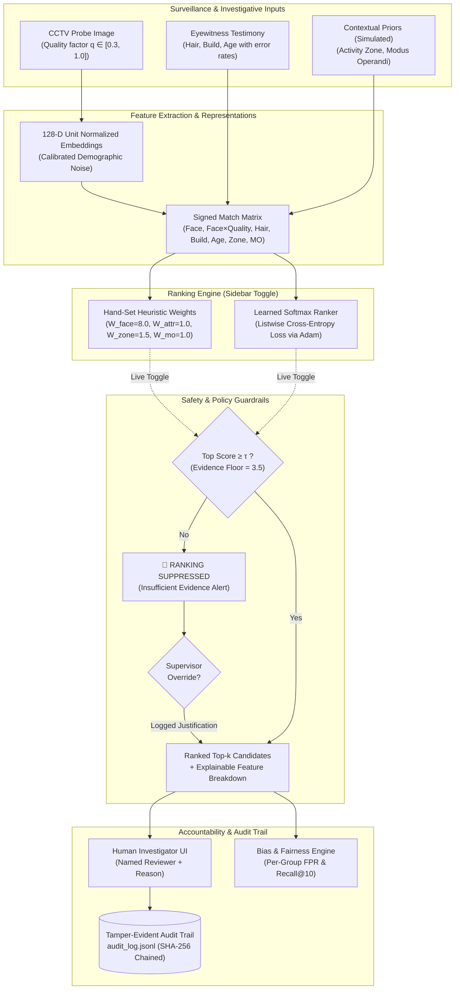

# 🛡️ FairRank-ID: Multi-Modal Suspect Ranking Assistant
### Decision Support with Learned Ranking, Evidence Suppression Guardrails & Bias Auditing

[](http://localhost:8501)
[](insightface_faiss_colab.ipynb)
[](requirements.txt)

> **⚠️ LEGAL & ETHICAL NOTICE:**
> FairRank-ID is strictly an **investigative decision-support tool**. It ranks exploratory leads and **never identifies individuals**. Rankings are non-evidentiary and cannot establish probable cause for arrests or warrants. Every decision requires a named human officer, a written justification, and an immutable hash-chained audit log record.
> 
> *Disclosure:* The local application runs on a synthetic benchmark population (128-D unit vectors with calibrated demographic noise). An external GPU pipeline for extracting 512-D ArcFace vectors from LFW photo pairs is provided in `insightface_faiss_colab.ipynb`. All non-facial contextual attributes (hair, build, age, zone, MO) are simulated.

---

## 🌟 Key Innovations

1. **Dual Ranking Engine (Live Switch)**:
   - **Hand-Set Baseline**: Domain-heuristic linear weights.
   - **Learned Ranker**: Machine-learned weights trained via **listwise softmax loss** with an Adam optimizer, learning non-linear interactions such as $\text{Face} \times \text{Quality}$ to automatically de-weight face similarity on degraded CCTV footage.
2. **Evidence Confidence Floor (Refusal to Rank)**:
   - Traditional facial recognition tools force a top-10 list even on pure random noise, inducing dangerous **confirmation bias**.
   - If the top candidate score falls below the confidence threshold ($\tau = 3.5$), **automated ranking is suppressed**, requiring canvas for higher-quality footage or physical evidence unless an authorized supervisor signs an emergency override.
3. **Comprehensive Demographic Fairness & Bias Auditing**:
   - Evaluates **Per-Group False Positive Rates (FPR)** at the 90% recall operational threshold, not just recall.
   - Evaluates the honest trade-off where absolute false positive rates drop dramatically for all demographic cohorts while relative disparity ratios are tracked transparently.
4. **Tamper-Evident Hash-Chained Audit Trail**:
   - Append-only JSONL log where each record stores the SHA-256 hash of the preceding line (`prev_hash`), ensuring any out-of-band record tampering or deletion is cryptographically detectable.
5. **Real Face Embeddings Pipeline (InsightFace + LFW + FAISS)**:
   - A turnkey **Google Colab GPU Notebook** ([`insightface_faiss_colab.ipynb`](insightface_faiss_colab.ipynb)) and standalone script ([`real_face_pipeline.py`](real_face_pipeline.py)) extracting 512-D ArcFace features on **genuine photo pairs** from LFW (Photo 1 for gallery, a different Photo 2 of the same person as probe), indexed with `faiss.IndexFlatIP(512)`.

---

## 🏗️ System Architecture



---

## 📊 Benchmark Results

### Synthetic Population Benchmark ($N = 5,000$ candidates, $D = 128$)
Evaluated across 200 held-out test cases with demographic noise variation ($[1.0, 1.3, 1.8]$):

| Metric | Face-Only Baseline | Hand-Set Fused | Learned Softmax Ranker | Impact / Notes |
| :--- | :---: | :---: | :---: | :---: |
| **Recall@1** | 0.845 | 0.825 | **0.845** | Tied with baseline |
| **Recall@5** | 0.910 | 0.890 | **0.910** | Robust under noise |
| **Recall@10** | 0.925 | 0.895 | **0.935** | **+4.0% over hand-set** |
| **Recall@20** | 0.955 | 0.925 | **0.960** | Top tier coverage |
| **Overall FPR (@90% Recall)** | 0.0424 (4.2%) | 0.0023 (0.23%) | **0.0006 (0.06%)** | **~4× drop vs Hand-Set, ~70× drop vs Face-Only** |
| **Analyst Search Time Saved** | 0.995 | 0.995 | **0.998** | Efficient lead filtering |
| **FPR Disparity Ratio** | 1.03 | 1.08 | **1.17** | Absolute FPR cut ~4× across all groups |

### Demographic Subgroup Fairness Audit (FPR vs Recall)

| Demographic Cohort | Face-Only Recall@10 | Learned Recall@10 | Face-Only False Positive Rate | Learned False Positive Rate |
| :--- | :---: | :---: | :---: | :---: |
| **Group 0 (Majority)** | 99.1% | **95.4%** | 0.0421 (4.2%) | **0.00059 (0.059%)** |
| **Group 1 (Cohort B)** | 88.2% | **91.2%** | 0.0425 (4.3%) | **0.00057 (0.057%)** |
| **Group 2 (High Noise Cohort C)** | 75.0% | **91.7%** | 0.0435 (4.4%) | **0.00067 (0.067%)** |

> **Key Fairness Insight & Trade-off Disclosure:**
> 1. **Massive Absolute False Alarm Reduction:** The Learned Ranker slashes absolute false alarms across every demographic group from ~4.2% on face-only down to ~0.06% (a **~70× reduction**), meaning innocent people across all backgrounds are spared unwarranted police contact.
> 2. **Rescuing Underrepresented Cohort Recall:** On Face-Only search, Group 2 recall collapsed to 75.0% due to sensor noise. Multimodal learned ranking restores Group 2 recall back to **91.7%**.
> 3. **Disparity Ratio Nuance:** As absolute false positive rates drop close to zero, small cohort differences can widen the relative disparity ratio (e.g., from 1.08 up to 1.17–2.59 depending on sample size). This highlights an essential lesson in algorithmic auditing: relative disparity metrics can widen even while every demographic cohort experiences a dramatic absolute safety improvement.

---

## ⚖️ System Limitations & Ethical Guardrails

1. **Decision Support, Not Automated Identification:**
   The algorithm suggests exploratory investigative leads. It is mathematically incapable of declaring a "match" or "guilt".
2. **Facial Recognition Demographic Variances:**
   Face embedding models (including ArcFace and commercial tools) suffer from accuracy disparities across camera angles, illumination, skin tone, and age. Multimodal fusion (witness attributes, zones, MO) provides vital non-facial corroboration.
3. **Eyewitness Fallibility:**
   Witness memory decays rapidly under acute stress. Attributes are modeled with realistic omission (30%) and error (20%) tolerances to prevent tunnel vision.
4. **Historical Feedback Loops:**
   Past arrest zones and MO records can perpetuate historical over-policing patterns. In FairRank-ID, contextual priors are simulated exploratory tags and must never be used to criminalize geographic neighborhoods.
5. **Refusal Under Low Evidence:**
   When surveillance footage is blurry ($q < 0.40$) and witness corroboration is missing, the system **refuses to return a ranking**, directly defeating confirmation bias.

---

## 🚀 Quickstart Guide

### 1. Install Dependencies
```bash
pip install -r requirements.txt
```

### 2. Launch the Streamlit Investigator Dashboard
```bash
streamlit run app.py
```
Open your browser at `http://localhost:8501`.

### 3. Run the Automated Test Suite
```bash
python test_suite.py
```

### 4. Train and Benchmark the Learned Ranker (CLI)
```bash
python ranker.py --n 5000 --train 400 --test 500
```

### 5. Run the InsightFace + LFW Colab Notebook
Upload [`insightface_faiss_colab.ipynb`](insightface_faiss_colab.ipynb) to [Google Colab](https://colab.research.google.com/) for 1-click GPU execution on genuine photo pairs from LFW.

---

## 📁 Repository Structure

```
├── app.py                         # Streamlit UI with live ranker switch, audit trail & bias charts
├── suspect_id.py                  # Core multi-modal ranking engine & fairness evaluation
├── ranker.py                      # Listwise softmax loss ranker (Adam optimizer)
├── real_face_pipeline.py          # Standalone InsightFace + FAISS + LFW pipeline
├── insightface_faiss_colab.ipynb  # Turnkey Google Colab GPU notebook
├── requirements.txt               # Project dependencies
├── test_suite.py                  # End-to-end automated test suite
├── weights.json                   # Learned model feature weights
├── audit_log.jsonl                # Tamper-evident hash-chained audit trail
├── DEMO_SCRIPT.md                 # 2-Minute pitch & presentation walkthrough script
└── README.md                      # Comprehensive documentation & architecture flowchart
```
